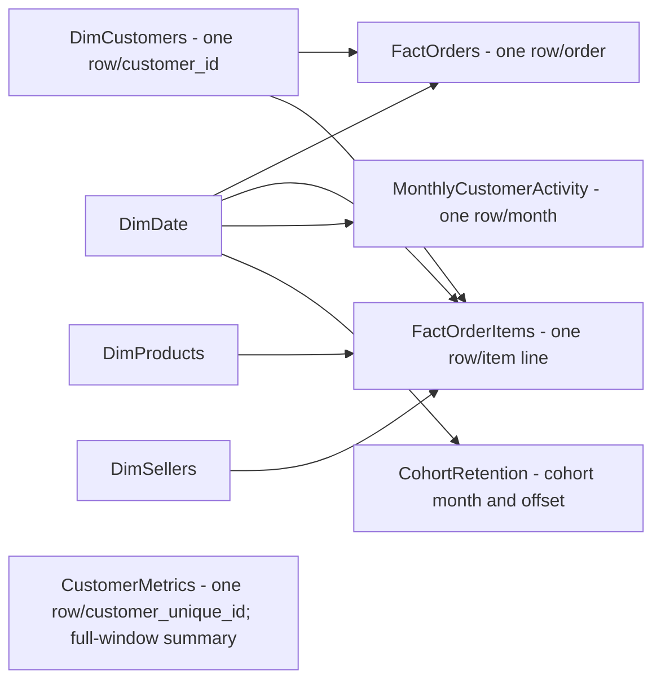

# RetailPulse Power BI Model Plan

## Source recommendation

Use the existing MySQL `retailpulse` database in **Import** mode. It keeps the report tied to the validated data layer; refresh imports a new copy. Power BI's MySQL connector requires Oracle MySQL Connector/NET on the Desktop computer. A local MySQL server also needs a standard on-premises gateway for Power BI service refresh. Prepared CSV extracts are a fallback, but require manual export/refresh and can drift from MySQL. Use a least-privilege read-only database account and never commit credentials. See Microsoft's [MySQL connector requirements](https://learn.microsoft.com/en-us/power-query/connectors/mysql-database) and [Import versus DirectQuery](https://learn.microsoft.com/en-us/power-bi/connect-data/desktop-use-directquery).

## Model overview

Use separate tables at their natural grains rather than one large flattened join. Dimensions filter facts in one direction. Do not relate the two facts directly.

| Table | Grain / key | Purpose |
|---|---|---|
| `FactOrderItems` | One row per `(order_id, order_item_id)` | Item-price revenue, item lines, freight as a separate transaction value, product and seller analysis. |
| `FactOrders` | One row per `order_id` | Delivered order counts, customer counts, and AOV; includes orders without item lines with zero item-price revenue. |
| `DimCustomers` | One row per `customer_id` | Order-specific customer record with `customer_unique_id`, city, and state. |
| `DimProducts` | One row per `product_id` | Original and translated category plus product attributes. |
| `DimSellers` | One row per `seller_id` | Seller city/state; optional analysis. |
| `DimDate` | One row per calendar date | Purchase-date filtering and chronological grouping. |
| `CustomerMetrics` | One row per `customer_unique_id` | Exported full-window delivered order count, revenue, first/last date, and repeat flag, produced using Phase 7 SQL logic; it is not an existing base table. |
| `MonthlyCustomerActivity` | One row per purchase month | Export of Phase 7 SQL monthly new/repeat customer counts and revenue; convert its `YYYY-MM` text key to the first date of that month in Power Query. |
| `CohortRetention` | One row per `(cohort_month, month_number)` | Phase 8 long-form retention result; normalize the revenue query's `months_since_first_purchase` name to `month_number` before merging on these keys. |
| `SecondPurchaseSummary` (optional) | One summary row | Phase 8 average/median days-to-second-purchase output. Keep its distribution query separate. |

`FactOrders` is a deliberate companion to the requested item fact: it preserves order-grain definitions and zero-line orders without averaging item rows. To build it, sum item `price` by `order_id` first, then left-join that result to orders and fill missing revenue with zero.

## Relationships

| One side | Many side | Relationship |
|---|---|---|
| `DimDate[Date]` | `FactOrders[purchase_date]` | 1:* single direction, active |
| `DimDate[Date]` | `FactOrderItems[purchase_date]` | 1:* single direction, active |
| `DimCustomers[customer_id]` | `FactOrders[customer_id]` | 1:* single direction |
| `DimCustomers[customer_id]` | `FactOrderItems[customer_id]` | 1:* single direction |
| `DimProducts[product_id]` | `FactOrderItems[product_id]` | 1:* single direction |
| `DimSellers[seller_id]` | `FactOrderItems[seller_id]` | 1:* single direction |
| `DimDate[Date]` | monthly/cohort extract month key | 1:* single direction; month key is first day of month |

`customer_id` is unique in `DimCustomers` and links an order to its customer record. `customer_unique_id` is the source-defined cross-order identity used for delivered customers, repeat purchase, frequency, customer revenue, and retention. It repeats in `DimCustomers`; never use it as the one-side relationship key. Keep `CustomerMetrics` standalone in the first model instead of creating a many-to-many relationship through that repeated identifier. Its full-window values do not respond to state, product, or date filters. Label them accordingly. The monthly SQL extract drives monthly new/repeat trends. A future dynamic customer-by-state model needs a separately designed and tested identity bridge.

## Fact grains and join safety

`FactOrderItems` includes `order_id`, `order_item_id`, `product_id`, `seller_id`, `customer_id`, `customer_unique_id`, purchase date, status, `price`, and `freight_value`. Resolve order/customer attributes with many-to-one joins and verify the item row count and composite key remain unchanged. Delivered revenue is `SUM(price)` filtered to delivered orders. Freight is not seller cost.

`FactOrders` has one order row with customer keys, purchase date, status, and `order_item_revenue`. This is the sum of item `price` per order; it is zero when the left-joined item aggregate is missing. AOV is the average of that one value per delivered order, not an average of lines.

Do not join payment rows to item lines: one order may have multiple rows in both tables, multiplying sums. If payment analysis is later needed, keep a separate payment-grain fact keyed by `(order_id, payment_sequential)` or preaggregate to one row/order. Reviews likewise remain separate at `(review_id, order_id)`. Payment value is not item-price revenue.

Product and seller filters affect `FactOrderItems`; they do not automatically filter `FactOrders` or the full-window customer summary. Use item-context order counts for product selection, and make order-grain card interactions explicit instead of implying unsupported cross-filtering.

## Dimensions and date table

- **DimCustomers:** one row/customer_id with customer_unique_id, city, and state. State is the order-linked customer record, not a geolocation-derived location.
- **DimProducts:** one row/product_id; keep source category, translated category, weight, dimensions, and useful photo count. Display category fallback is translated label, then source label, then `Unknown`. Preserve uncategorized products.
- **DimSellers:** one row/seller_id with seller city/state. Keep seller visuals secondary.
- **DimDate:** continuous calendar from minimum through maximum observed `orders.order_purchase_timestamp` across statuses. Relate actively to purchase date only. For delivery/payment dates later, use another role-playing date table or a deliberate inactive relationship.

Include Date, Year, Quarter, Month Number, Month Name, Year-Month (`yyyy-MM`), and Year-Month Sort (`Year * 100 + Month Number`); sort Year-Month by that key. Week number is optional and should use a stated Monday-start convention only if a weekly page is built. Mark the table as a date table. First/last observed months may be partial.

## Precomputed customer and cohort outputs

Create/export a read-only result using the existing Phase 7 customer-summary CTE logic for `CustomerMetrics` at one row/customer_unique_id (the script does not create a permanent summary table): delivered_orders, total_revenue, average_order_value, first_purchase_date, last_purchase_date, active_span_days, and `repeat_customer_flag` (`delivered_orders >= 2`). Recency, if derived, is relative to the latest delivered purchase in this dataset, not today. Use this static table for whole-window ranking/frequency only.

Export the Phase 7 monthly SQL output for `MonthlyCustomerActivity`; its `month` field is text in `YYYY-MM` form, so convert it to a date representing the first of the month before relating it to `DimDate`. Its first-versus-repeat sequencing uses delivered orders ordered by purchase timestamp and order_id. A customer can have both a new and repeat purchase in one month.

Use Phase 8 SQL output for `CohortRetention`. SQL has already deduplicated customers at customer-month grain and handles mature horizons. This is easier to explain and validate than rebuilding window logic in DAX. Retention is observed within the dataset window, not churn; keep immature horizons blank.

## Source-table scope and safety

This is a plan only: it creates no PBIX, SQL view, or database object. Start with read-only imports; omit payments/reviews until separately modeled. Store credentials only in Power BI's local credential store, not in M code, screenshots, Git, or project documentation.
